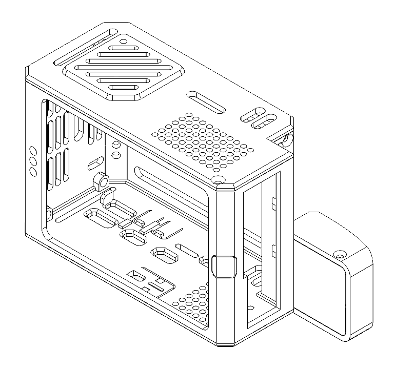
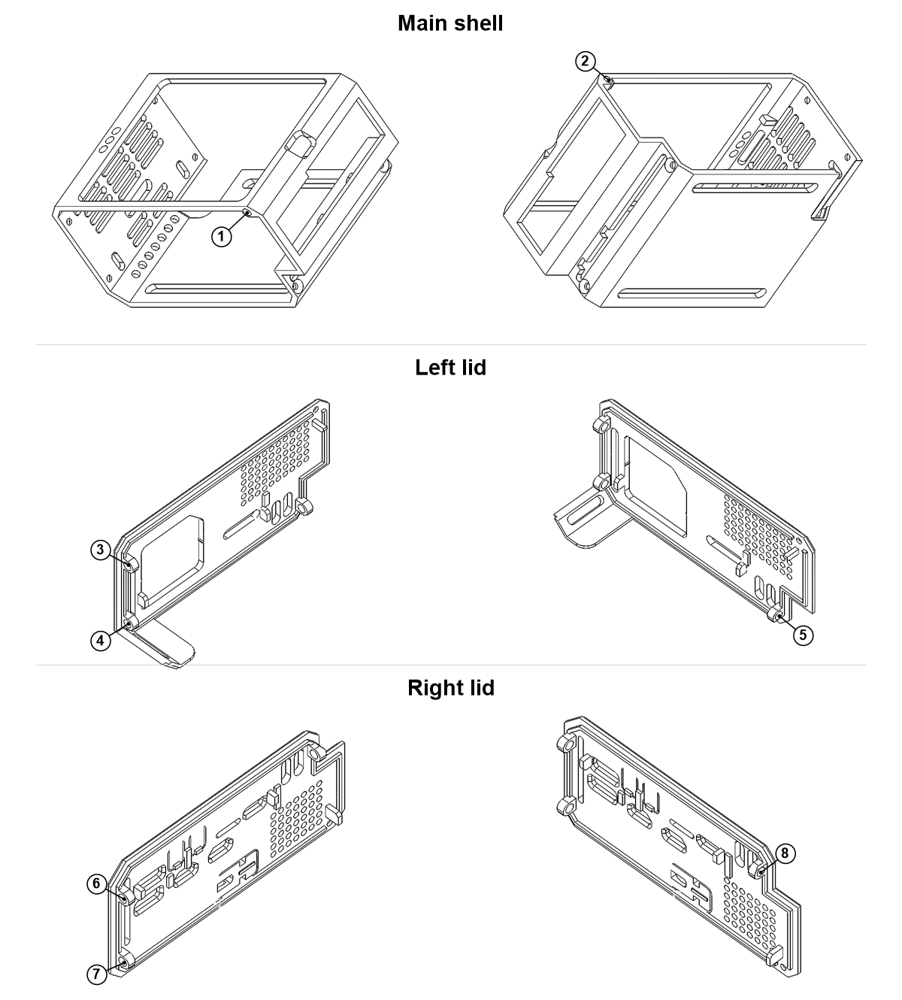

# Pi 5 WhisPlay Plus Chatbot Case

3D-printable case for Raspberry Pi 5, PiSugar 3 Plus, and WhisPlay Plus. The Raspberry Pi Camera Module 3 mount is optional.

## Case hardware

| Part | Specification | Quantity |
| --- | --- | ---: |
| Threaded insert nut | M2 thread, Ø3 mm outside diameter, 2.5 mm insertion depth | 8 |
| Countersunk screw | M2 × 4 mm | 8 |

## Install the threaded inserts

Install one insert at each numbered location before fitting the lids. The main shell takes two inserts, one at each side opening. Each lid takes three inserts, two at one end and one at the other. Seat the inserts flush with the hole openings, then secure the case with the eight countersunk screws.

## Optional camera mount

The Raspberry Pi Camera Module 3 uses the same mount assembly and fasteners as the [original Pi 5 WhisPlay Chatbot case](../pi5-whisplay-chatbot/README.md#screw-type-for-camera). Fit the camera module into the mount, route the ribbon cable through the opening, and install the rear cover. The camera assembly requires **six additional M2 × 3 mm countersunk screws**.
